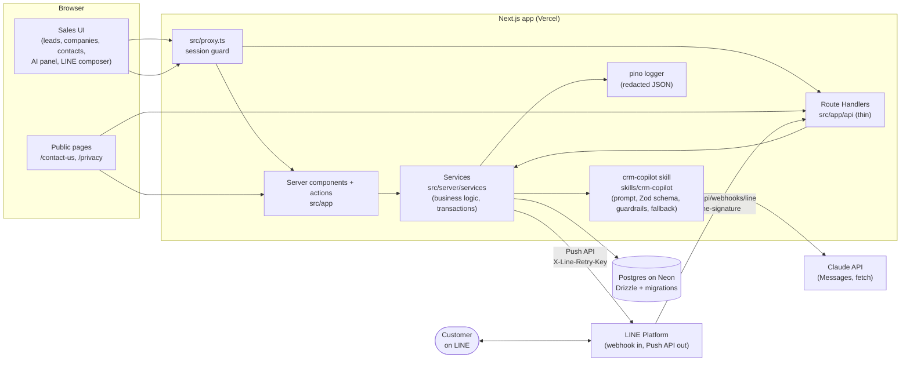
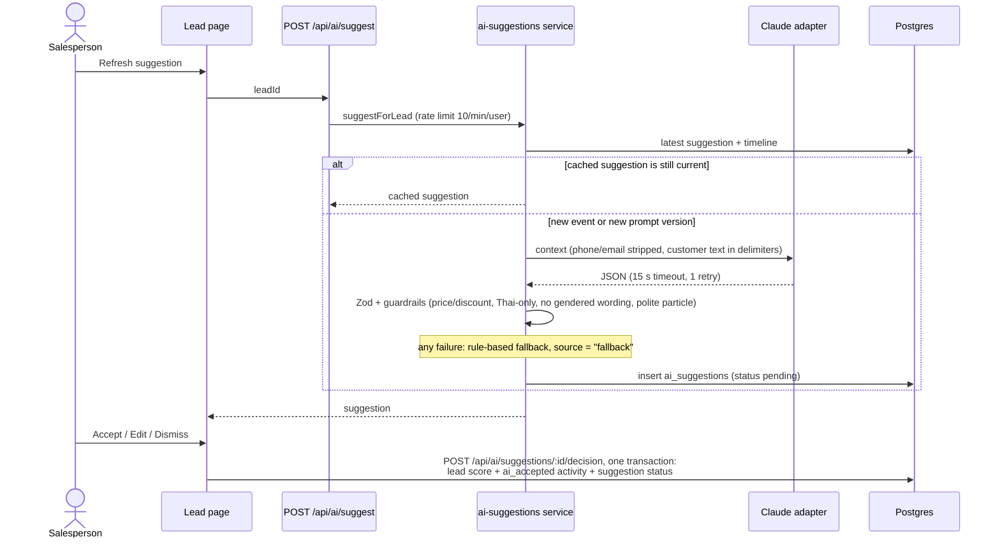

# Architecture

One Next.js app (pages + Route Handlers) on Vercel, one Postgres database (Neon), the Claude API for AI suggestions and the LINE Messaging API for chat. Diagrams below are drawn from the code; file references are in each section.

## Components



Notes:

- **Auth.** `src/proxy.ts` is the first gate (no session → `/login` for pages, 401 for APIs). Public: `/login`, `/contact-us`, `/privacy`, `/api/auth`, `/api/public`, `/api/webhooks`. Every private route handler checks the session again in `withAuth` (`src/server/http.ts`).
- **Business logic** lives in `src/server/services/*`; route handlers parse with Zod and call a service. A write and its `activities` row share one transaction.
- **AI never writes confirmed data.** The skill returns a Zod-validated suggestion that is stored as `pending` in `ai_suggestions`; only a person's Accept/Edit changes the lead and writes an activity. Failures (timeout, 5xx/429, bad JSON, guardrail) fall back to a rule-based suggestion with `source: "fallback"`. Details: [skills/crm-copilot/SKILL.md](../skills/crm-copilot/SKILL.md).
- **Tests** run the same services against in-memory pglite, with mock LLM and LINE adapters (`LINE_ADAPTER=mock` is the default), so CI needs no database or secret.
- **Rate limiting** is an in-memory fixed window per server instance (public lead intake, AI suggest).

## Data flow: AI suggestion



## Data flow: LINE inbound and outbound

```mermaid
sequenceDiagram
  actor C as Customer (LINE)
  participant L as LINE Platform
  participant W as POST /api/webhooks/line
  participant D as Postgres
  participant S as Salesperson
  participant O as POST /api/messages

  Note over C,D: Inbound
  C->>L: message or Quick Reply tap
  L->>W: webhook (raw body + x-line-signature)
  W->>W: HMAC-SHA256 on raw body, timingSafeEqual
  alt signature invalid
    W-->>L: 401, nothing stored
  else valid
    W->>D: insert line_events ON CONFLICT (webhook_event_id) DO NOTHING
    W-->>L: 200 { received } (fast)
    Note over W,D: processed after the response (after())
    W->>D: map line_user_id to contact (create contact + lead, source = line, if new)
    W->>D: store message (in) / quick_reply activity (+ score, once per button)
    opt first message from this user
      W->>L: fixed privacy notice (only automatic reply)
      W->>D: consent activity + contacts.consent_at (only after LINE accepted it)
    end
  end

  Note over S,L: Outbound (always approved by a person)
  S->>O: approve and send (AI draft or typed text)
  O->>D: message approved + note activity, retry_key = UUID (one transaction)
  loop up to 3 attempts, backoff 250 ms / 750 ms on 5xx or timeout; stop at once on 4xx
    O->>L: Push API with X-Line-Retry-Key
  end
  alt LINE accepted
    O->>D: status sent + message_sent activity
  else gave up
    O->>D: status failed (Retry button re-sends with the same key)
  end
  L->>C: message
```

Why Push and not Reply: a reply token expires quickly, so it cannot wait for a person to approve. The same `X-Line-Retry-Key` on every attempt (and on Retry) lets LINE deliver the message once however many attempts it took. LINE payload shapes and the Retry-Key behaviour were written from the LINE docs and should be re-checked against the Messaging API reference when this goes beyond a demo.

## Where things are

| Concern | Location |
| --- | --- |
| Schema, migrations, seed | `src/server/db/schema.ts`, `drizzle/`, `src/server/db/seed.ts` |
| Route guard | `src/proxy.ts` |
| Response/error shape, `withAuth`, requestId | `src/server/http.ts`, `src/server/errors.ts` |
| CRM services | `src/server/services/{leads,contacts,companies,activities}.ts` |
| AI services and adapters | `src/server/services/ai-*.ts`, `skills/crm-copilot/` |
| LINE | `src/server/services/line/*` |
| Logger and redaction | `src/server/logger.ts` |
